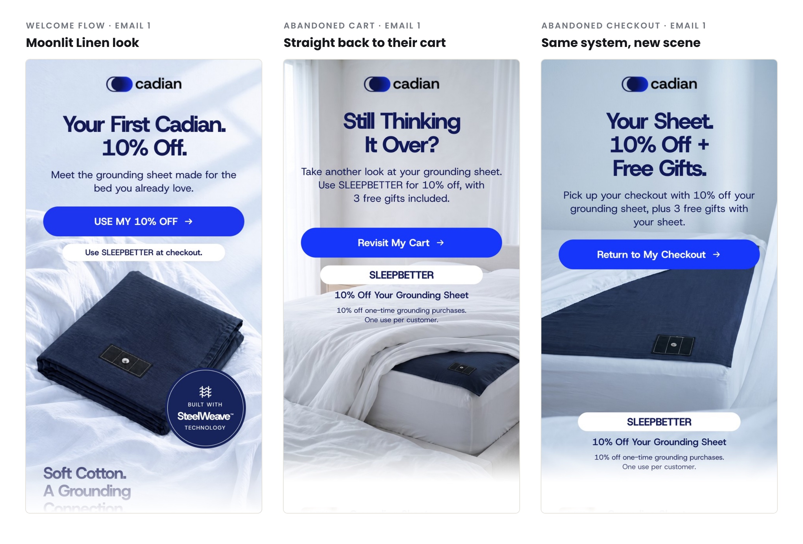
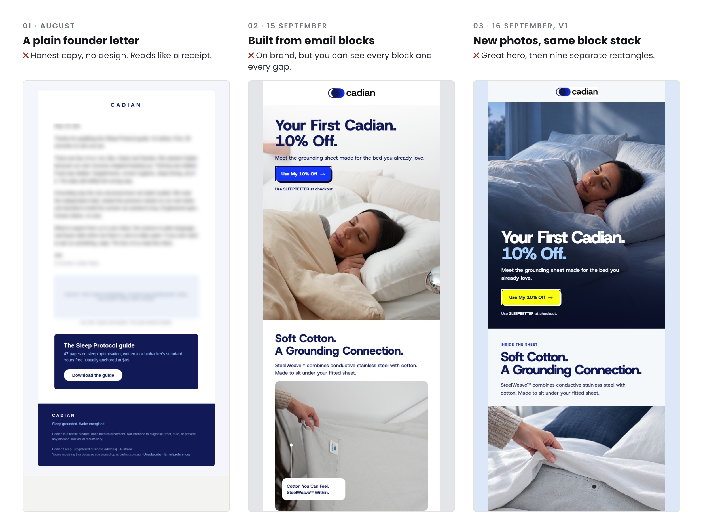
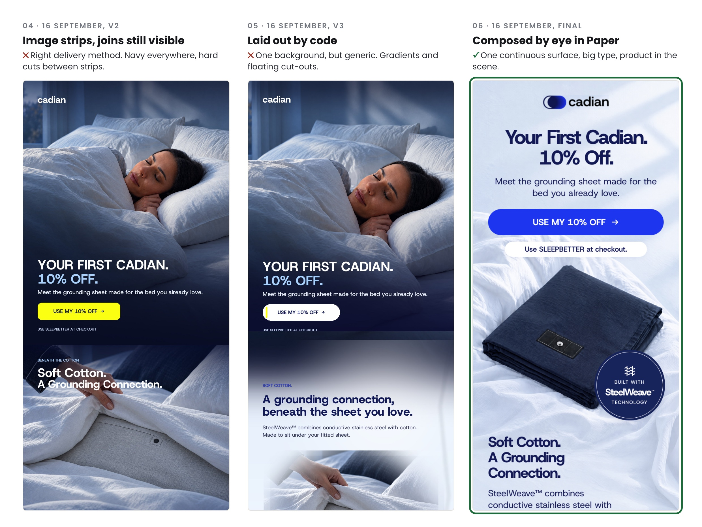
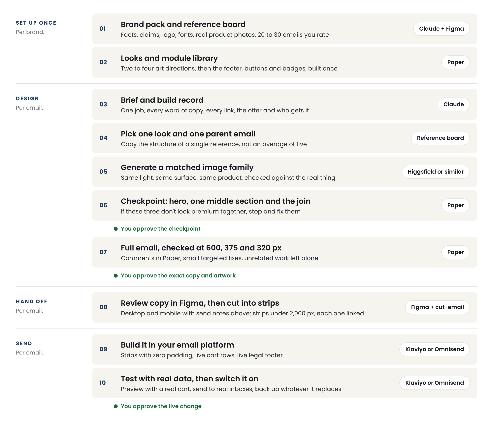
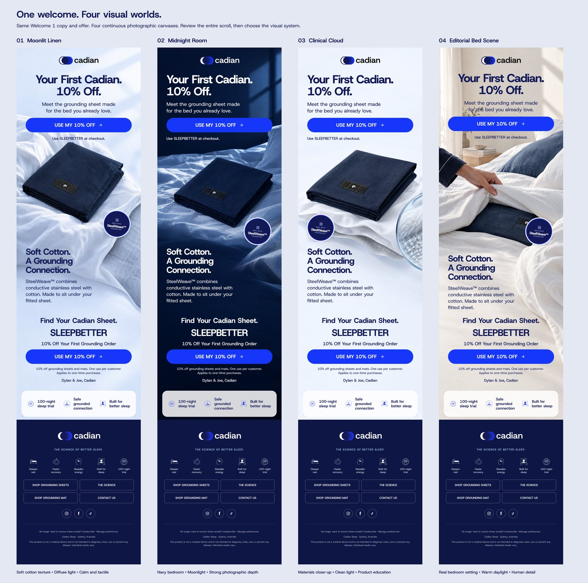
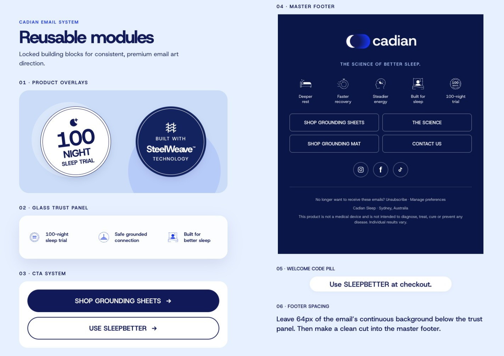
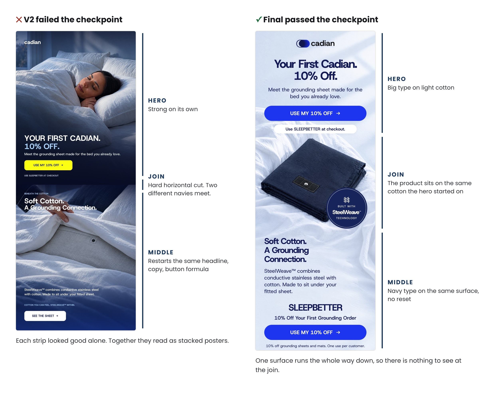
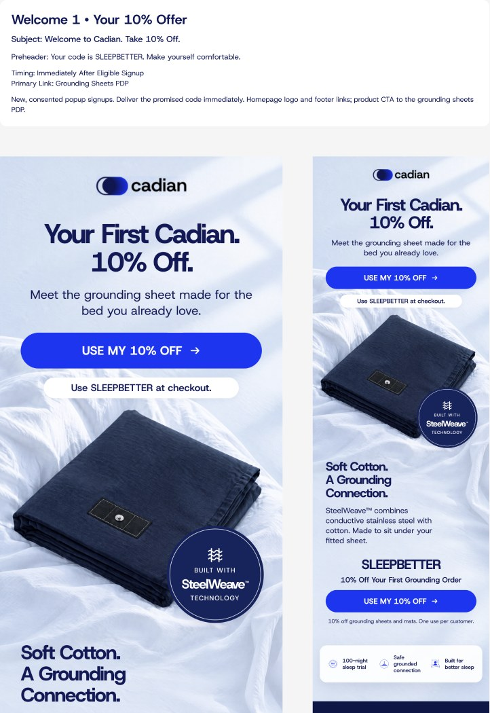
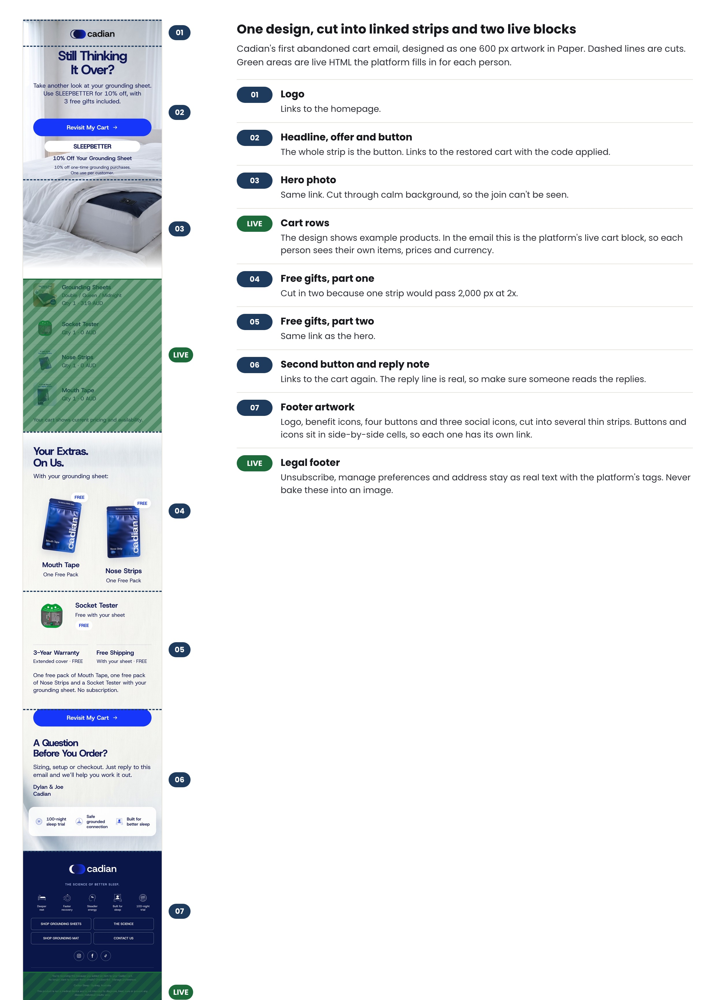

# The Paper Email Workflow

How we design premium, image-led emails with Claude and Paper, then get them live in Klaviyo or Omnisend. Built on Cadian Sleep's welcome and abandonment flows, including everything that went wrong on the way.

[Download the PDF](../The%20Paper%20Email%20Workflow.pdf)


## Start Here

This is the exact process we use to design the emails for Cadian Sleep, written up so you can run it on your own brand. It works whether you send from Klaviyo or Omnisend. Where the two platforms differ, there's a side-by-side table.

The short version: we design each email as one tall piece of artwork in a design app called Paper, with Claude doing most of the building and you making the taste calls. Then we cut the artwork into strips, and each strip goes into the email as one clickable image. The parts that change per person, like the cart and the legal footer, stay as live text.

**What you get at the end of each email**

- A finished design you can edit any time, in Paper
- A desktop and phone preview with the subject line, preview text and send notes sitting above it
- The email cut into clickable strips, ready to drop into Klaviyo or Omnisend
- A tested email in your platform, with the cart and footer working properly

**What's in the starter kit** (free on GitHub: [github.com/joekatf-ops/paper-email-workflow](https://github.com/joekatf-ops/paper-email-workflow))

- A skill file for Claude (more on skills in What You Need)
- The design rules, the brief template, the QA checklist and the handoff spec
- Every prompt in this guide, ready to copy and paste
- A small tool that cuts your design into strips and writes the email code for you

**Where this stands, honestly.** Cadian's welcome flow, abandoned cart flow and abandoned checkout flow run on this system: 13 emails, live since 16 September 2026. I can tell you it produces emails we're proud of. I can't tell you yet that they convert better than what we had, because we haven't measured that properly. Judge the method on the work, and measure your own results.



*The top of three live Cadian emails: Welcome 1, Abandoned Cart 1 and Abandoned Checkout 1. Each one is a single continuous design, cut into strips.*

## Why Most AI Emails Look Like AI

We got this wrong three times before we got it right, and the reason is the most useful thing in this guide.

When you ask an AI to "design an email", it builds what it knows: a stack of separate blocks. Logo block, headline block, image block, text block, button block, footer block. Each block has its own background and its own padding, so you can see every join. It looks like a template, because it is one.

Here's how Cadian's first welcome email went, version by version:



*Versions 1 to 3: a plain letter, then two block-built emails.*

- **The plain letter.** Fine copy, but nothing to look at.
- **Built from email blocks.** On brand, but nine separate rectangles with gaps between them.
- **V1: better photos.** We generated a much better hero image. It didn't help, because everything underneath was still a stack of blocks.



*Versions 4 to 6: image strips with visible joins, a layout placed by code, and the final design composed in Paper.*

- **V2: image strips.** We switched to the right delivery method, where each section is a picture. But we built each strip on its own, so every join was a hard line where one navy met a different navy.
- **V3: laid out by code.** We got one continuous background by having the AI place everything with code. It came out tidy and generic: gradients, floating product cut-outs and the same headline, paragraph and button formula over and over. It looked like Canva.
- **Final: composed by eye in Paper.** The same AI, working inside a real design tool, with a human approving the look before it built the rest.

**The root cause:** we were trying to automate the taste layer. Code is great for cutting, checking and sending. It's bad at deciding what looks premium. So the rule became: **the AI builds inside a visual design tool, and a human approves the look early.**

**The tells that make an email look AI-made.** If you see these, stop:

- Every section is a rounded rectangle with the same padding top and bottom
- The background colour changes hard at every section
- Every section repeats the same small label, headline, paragraph and button
- Images are clean rectangles dropped under the copy
- Product cut-outs float on the page with the wrong light and no shadow
- A gradient laid over every photo
- The whole email is dark "for consistency"
- Tiny body text and timid buttons
- The footer is the only part that feels like the brand

## The System on One Page



*Ten steps, four stages, three points where you approve before anything moves on.*

Each tool has one job. Mixing them up is where things went wrong for us.

| Tool | Its job | Not its job |
|---|---|---|
| Claude | Briefs, copy checks, building the design inside Paper, cutting, testing | Deciding what looks premium |
| Paper | The editable master of every email. Where design and comments happen | Delivering the email |
| Image generator (we use Higgsfield) | Photography in a matched style | Text, logos, buttons or prices in images |
| Figma (optional) | A review copy and archive with send notes | Editing the design. Paper stays the master |
| The cut-email tool | Cutting strips, writing the email code, checking the strips fit back together | Design decisions |
| Klaviyo or Omnisend | Sending, the live cart, the footer, the flows | Design |

**The four rules that matter most**

1. **Design the background first.** One surface, one light source, running the whole way down. Content sits on top of it.
2. **Approve a checkpoint before the full build.** The hero, one middle section and the join between them. If those three don't look premium together, the full email won't either.
3. **Each strip is one big clickable image.** The button is drawn into the artwork and the whole strip links. Nobody has to aim for a small button.
4. **Anything personal or legal stays live.** Cart items, prices, recovery links, unsubscribe and address are never baked into a picture.

## What You Need

| Tool | What it's for | Plan you need (checked October 2026) |
|---|---|---|
| Claude | The assistant that does the building | A paid plan. Claude Code works best for this |
| Paper Desktop | Designing the emails | Pro. The free plan allows 100 AI actions a week, and one email uses far more than that |
| Higgsfield or another image generator | Matched photography | Paid plan. Generations cost credits |
| Figma (optional) | Review copy and archive | Writing to files outside your drafts needs a Full seat |
| Klaviyo or Omnisend | Sending | Your existing plan |
| Node.js (free) | Runs the cut-email tool | Install the LTS version from nodejs.org |

**Three terms you'll see a lot**

- **Claude Code** is Claude running on your own computer. It can open files, run tools and work inside other apps for you. You talk to it in plain English, the same as the chat.
- **A connector** (the technical name is MCP) is a plug that lets Claude work inside another app. With the Paper connector, Claude can read your designs, build new ones and read your comments.
- **A skill** is a saved instruction file Claude reads before a job, so it does the job the same way every time. The starter kit includes one for this workflow.

**Connecting the apps**

- **Paper:** install Paper Desktop and open a file. In Paper's connector panel, click Add to Claude. That works for both Claude Code and the Claude desktop app. In Claude Code, type `/mcp` to check it's connected.
- **Figma:** in Claude's settings, go to Connectors and add Figma. In Claude Code, the address is `https://mcp.figma.com/mcp`. Sign in when it asks.
- **Higgsfield:** in Claude's settings, add a custom connector with the address `https://mcp.higgsfield.ai/mcp` and sign in.
- **The starter kit:** in Claude Code, type `/plugin marketplace add joekatf-ops/paper-email-workflow` and press Enter, then `/plugin install premium-email-workflow@paper-email-workflow`. Restart Claude Code. That installs the skill, the reference files and the cut-email tool in one go. Start your first message with "Use the premium email workflow skill".

**Your folder.** Make one folder for your email work and open Claude Code in it. Put a Brand folder in there with your logo files, fonts and real product photos.

## Set Up Your Brand Once

You do this once per brand. Every email after that is faster and more consistent, because Claude starts from the same rules and the same parts each time.

### 1. The Brand Pack

Claude can't design well for a brand it doesn't know. Before any design, collect:

- **What you can and can't say.** One page of approved claims, offers and words you never use. If you sell anything health-adjacent, this matters more than anything else in this guide.
- **The offer.** Prices, codes, gifts, guarantees, shipping, and who qualifies for each.
- **Logo files** as SVG, the transparent vector version. Never let the AI redraw your logo.
- **Fonts.** Install them on your computer so Paper can use them.
- **Real product photos** from several angles. These are the reference for every generated image, so the product never comes out wrong.
- **Voice.** How you write, who signs the emails, spelling, words you never use.

Use prompt A1 in the appendix to turn this into a design rules file. The kit's `design-rules.md` shows the format, with Cadian's values as the example.

### 2. A Reference Board

Collect 20 to 30 emails you think are genuinely good, as full-length screenshots, into one Figma or Paper board. Group them by brand, with the subject line above each. Subscribe to the brands you rate, or pull examples from an email library like Milled or Really Good Emails.

Then go through them and note what feels premium, what feels cheap, and what you'd never do. That's your taste written down, and Claude will use it on every email.

The brands we leaned on for Cadian, and what we took from each:

| Reference | What we borrowed | What we left |
|---|---|---|
| Mars Men | One continuous environment, purposeful light, strong hierarchy | Their palette and sci-fi styling |
| Mellow | Sleep-category warmth, big readable type, tactile product shots | Small copy squeezed into their spacing |
| Grüns | One branded surface, the product visible almost the whole way down | The busy repetition |
| IM8 | Restraint, confident scale, short education | Gradients with no purpose |

**One parent per email.** When you build an email, pick a single reference email and copy its structure: how the background behaves, the pacing, the image density and the transitions. Don't average five brands together. Our V3 failed partly because it was an average of Mellow, Grüns and IM8, so it had no point of view.

### 3. Your Looks

A look is a complete visual world: background, light, photography style and contrast. We built four for Cadian and kept all four:



*Same copy, same offer, four looks. Moonlit Linen (left) became the welcome flow.*

| Look | Feel | Best for |
|---|---|---|
| Moonlit Linen | Warm white and powder blue, soft cotton folds, diffuse cool light | Welcome, comfort, discovery |
| Midnight Room | Deep navy, real bedroom depth, moonlight | Night routines, dramatic offers |
| Clinical Cloud | Cool paper, silver, close-ups of the material | How it works, setup, FAQs |
| Editorial Bed Scene | Daylight bedroom, hands, product in use | Lifestyle, founder notes, seasonal |

Two to four looks is plenty. Build the same email in each (prompt A3), lay them side by side, and decide. Pick the look that suits each email's message rather than rotating through them.

What stays the same across every look: the logo, the fonts, the button style, the icons and the footer. What changes: the scene, the camera angle, the room, the crop. **Never reuse the same background for every email.** Keep the brand and change the scene.

### 4. The Module Library

Build the parts that repeat once, in Paper, and lock them: buttons, trust badges, the benefit panel, the code pill and the footer.



*Cadian's locked modules. Claude reuses these exact parts instead of rebuilding them, so nothing drifts.*

Claude can drop an exact copy of a module into a new email, so the footer in email 13 is identical to the footer in email 1. Set the footer up as a clean hard cut from the email above it, with your logo, a few benefits, four navigation buttons, social icons and space for the live legal text.

## Build One Email

### Which Emails First

If you're starting from nothing, build the flows that bring in the most money first. For us that was:

| Flow | Emails | Sends after |
|---|---|---|
| Welcome | 5 | Someone signs up |
| Abandoned checkout | 3, plus 1 neutral version | Checkout started, no order. Ours waits 1 hour |
| Abandoned cart | 3, plus 1 neutral version | Added to cart, no checkout. Ours waits 2 hours |

The neutral version matters. Our cart emails talk about the grounding sheet offer and its free gifts, and someone with only nose strips in their cart doesn't qualify. So the flow splits: sheet carts get the three sheet emails, everyone else gets one neutral email with no sheet offer. In Klaviyo the split condition is "Items contains" a product. In Omnisend it's a split condition on the cart contents.

### Step 1: Brief and Build Record

Every email starts with a build record (the template is in the kit). One email, one job. Fill in:

- The job: one sentence on what this email has to make someone do
- Who gets it, and who doesn't
- Subject line and preview text, written as a pair. The preview carries on from the subject, it never repeats it
- Every word of body copy, every button label and every link
- The offer and its conditions, checked against your live store today, not a screenshot from last month
- Which look and which parent reference

Write the copy before the design. Image emails punish long copy, because it all becomes picture. Keep it short and big.

### Step 2: Plan and Generate the Images

Write a shot plan before generating anything. For each scene: camera position, light direction, surface, crop, where the product sits, and where the text will go.

Then generate the images as a family: same light, same surface, same colour, so they look like one shoot. Rules we learned the expensive way:

- Generate photos with **no text, logos, prices or buttons** in them. All copy stays editable in Paper.
- Always give the generator your real product photos as references. Don't let it invent hardware or packaging.
- **Check every image against the real product** before using it. For us that meant the connector, the snap, the strap direction, the weave and the plug, which has to be the Australian type, never a generic or UK one. Reject a beautiful image if the product is wrong.
- Not every section needs a full photo. A close-up or a cut-out on the same surface often works better.
- Tell Claude the generation budget before it starts. Generations cost money.

### Step 3: Background First, Then the Checkpoint

In Paper, Claude builds the background first: one surface running the full length of the email. Then the hero, one representative middle section, and the join between them. **Stop there.**

Look at the three together at actual size. Ask:

- Can you see where one section ends and the next begins? You shouldn't be able to.
- Is the text big enough to read on a phone?
- Does the product look real, and is it sitting in the scene rather than floating on it?
- Does it look like your reference email, or like a template?

If the answer is wrong, fix it here. We multiplied an unresolved look into three full emails before we learned this.



*Left: V2 failed because the join is a hard cut and the middle restarts the same formula. Right: the final version passed because the product sits on the same cotton the hero started on.*

### Step 4: The Full Email

Once you've approved the checkpoint, Claude extends the same system down the whole email, reusing your locked modules.

**Type sizes that worked for us**, on a 600 px wide design:

| Element | Size |
|---|---|
| Hero headline | 58 px, extra bold, tight letter spacing |
| Section headline | 42 px, extra bold |
| Body copy | 26 px |
| Button label | 26 px, extra bold |
| Main button | 512 × 76 px, fully rounded |
| Space above the footer | 64 px of the email's own background |

These look huge on a desktop canvas, but an image email shrinks on a phone: 26 px body copy becomes about 16 px on a 375 px wide phone and about 14 px on a small 320 px phone. **Always check the design at 600, 375 and 320 px** before approving it.

**Other rules from our design file:**

- No small labels above headlines. Every AI design adds them and they make everything look templated.
- Dark text on light backgrounds, white text only on properly dark ones.
- Use gradients rarely. A gradient over every photo is a tell.
- Don't make the whole email dark. Mix dark moments with light, open space.
- Buttons are big and bold. A tiny label floating in a huge button looks timid.
- Keep the product visible most of the way down, especially at the offer.
- The footer starts with a clean hard cut. It's the one place a hard line is right.

### Step 5: Comments and Approval

Leave comments directly on the design in Paper. Claude can read Paper comments, so you say "apply the comments on Welcome 2" and it works through them.

Make sure it:

- Changes only what the comments ask for, and leaves approved photos and copy alone
- Shows you a before and after
- Checks the spacing around anything it changed, at desktop and phone size

Approve the **exact version**: copy, artwork, subject and preview text together. If any copy changes after that, that part needs approving again.

## Hand Off to Figma (Optional)

We keep a review copy of every approved email in Figma, because it's where other people look at our work. If you're a one-person team, you can skip this and keep the send notes next to each design in Paper. We do that too.



*Welcome 1 in our Figma file: email name, subject, preview text, timing and notes on top, the 600 px desktop design on the left, the phone preview on the right.*

If you use Figma, the spec we settled on:

- One page per flow, plus a page of reusable assets
- For each email, a Desktop frame at 600 px and a Phone frame at 375 px, side by side, with no boxes, borders or backgrounds around them
- The frame names include the exact size and ratio, for example "Welcome 1 / Desktop / 600 x 2550px / 4:17"
- Above each pair, as editable text: subject, preview text, timing, who gets it, the main link and any notes
- Use the approved export. Never rebuild the design from scratch in Figma
- **Split tall images into tiles no taller than 4,096 px.** Our first long imports showed as "done" but appeared blank in Figma. Always look at the actual canvas before you call it finished.

The phone frame is the same image scaled down. It's not a separate phone layout, so read the small text on it carefully.

## Cut It Into Strips

This is the step people get stuck on, so the kit includes a tool for it.



*One Paper design becomes a stack of linked strips with two live blocks the platform fills in for each person.*

**Export.** Export the approved design from Paper at 2x, so 1,200 px wide. Twice the size keeps it sharp on phone screens. If a tall export comes out with missing or half-loaded photos, export it again as a JPG, or export section by section.

**Plan the cuts.** Decide where each strip starts and ends, in the design's 600 px coordinates. Claude can read these straight from Paper. The rules:

- **Cut where the link changes.** Each strip is one link. A footer row with two buttons becomes two images side by side, so each button has its own link.
- **Keep every strip under 2,000 px tall at 2x**, so under 1,000 px on the design. Omnisend rejects anything bigger, and Klaviyo advises the same limit. A tall gift panel becomes two strips.
- **Cut through calm background**, never through a face, a line of text or a product edge.
- **Mark where the live blocks go.** In the cart email above, the design shows example products so you can judge the layout, but in the email that space is the platform's live cart block.

**Run the tool.** Prompt A11 asks Claude to run the cut-email tool for you. It:

- Converts the colours properly. Paper exports in a wider colour format (Display P3) than email uses (sRGB). If you skip the conversion, your colours come out noticeably flatter than the design.
- Fills see-through areas with your background colour. Paper leaves sections transparent if they don't have their own fill, and those turn black in a JPG.
- Cuts the strips, saves them as JPG or PNG (whichever is smaller), and warns if one is too heavy.
- Writes the email code, a preview page with a desktop and phone view, and a block-by-block list for building by hand.
- Puts the strips back together and checks they match the original exactly, so there are no gaps or missing rows.

**Alt text.** Every strip needs a description. It shows when images are blocked and it's what screen readers read out. Write what the strip says: the headline, the offer and the code. "Image" or "hero" is useless.

## Build It in Klaviyo or Omnisend

There are two ways to put the strips in. Pick one.

- **Drag and drop (easiest).** One Image block per strip, padding set to zero on every side, each with its link and alt text. The tool's `blocks.md` lists every block in order.
- **One HTML block (fastest once set up).** Upload the strips to your platform's image library, give the tool the hosted links, and paste the finished code into a single custom HTML block. This is how our live emails are built.

**The differences that matter** (checked against both platforms' help centres, October 2026):

| | Klaviyo | Omnisend |
|---|---|---|
| Image limits | 10 MB max, 1 MB or less recommended. Under 2,000 px tall for full-width images | 5 MB max, under 2,000 px on both sides |
| Removing gaps | Set padding to 0 in the image block and the section styles. Block settings override section settings | Use the image block's Remove padding button. Check the layout padding too |
| Live cart rows | Started Checkout: a dynamic table with row collection `event.extra.line_items`. Added to Cart holds one product, so use a static table | The Abandoned Products block, one per email |
| Link back to checkout | `{{ event.extra.checkout_url }}`. Added to Cart emails use `{{ event.URL }}` instead | The Checkout button's abandoned cart preset, or `[[event.raw.abandoned_checkout_url]]` |
| Unsubscribe | ``. Required in every email | Added to promotional emails automatically. Hiding it can get your account suspended. Tag: `[[unsubscribe_link]]` |
| Preferences | `` | `[[preference_link]]` |
| Address | `{{ organization.full_address }}` | Type it into the footer |
| Splitting sheet vs neutral | Conditional split: Items contains the product | A split condition on the cart contents (this is what we run) |
| Safe testing | Set the email to Manual. People queue for review instead of receiving it | Preview as one of your contacts to see a real cart |

**Live text.** Both platforms warn that emails made only of images are more likely to land in spam. Keep the legal footer as real text, and consider one short line of live text near the top. The tool can add one for you.

**Size.** Gmail cuts off emails whose code passes about 102 KB. Image emails stay well under that, because only the code counts, not the pictures. Our live emails carry between 0.4 and 1.9 MB of images each, and they loaded without problems in the platform's phone previews.

**Subject and preview text** go in the platform's own fields, not the artwork. Copy them from the build record so they match what you approved.

## Test Before It Goes Live

A test email that "sent" is not a test email that arrived and looked right. Check each of these:

- [ ] **Real data.** Preview with a real person's cart, not the platform's sample. In Klaviyo, preview with a recent event. In Omnisend, preview as one of your contacts. A plain test send doesn't fill in cart data.
- [ ] **Every link.** Click every strip. The recovery link should land on that person's cart or checkout, in their currency.
- [ ] **Sheet and neutral paths.** Run one cart with the qualifying product and one without. The neutral email must not show the offer or gifts.
- [ ] **Inboxes.** Send to Gmail, Outlook and Apple Mail, and look on an actual phone.
- [ ] **Images off.** Turn images off and check the alt text and live footer still make sense.
- [ ] **Dark mode.** Look at it in dark mode.
- [ ] **Small text.** Read the smallest text on a small phone.
- [ ] **Joins.** Scroll the whole email slowly on a phone and look for lines between strips.
- [ ] **Unsubscribe and preferences** both work.

**Before replacing a live email:** back up what's there. Then change only the content. Don't touch triggers, delays, exits or who's in the flow. Afterwards, read it back to confirm what's live matches what you approved.

## Changing a Live Email Later

You'll change copy more often than design. The pattern that works:

1. Edit the text in Paper. Keep the design the same height, so the cuts don't move.
2. Export again and cut at exactly the same positions as before.
3. Re-upload only the strips that changed, and swap them in.
4. Update the alt text for those strips.
5. Read back every changed email and look at it whole.

On 30 September we took every dollar amount out of our cart and checkout emails, because the store started selling in five currencies and a fixed AUD figure was wrong for most people. "$152 in extras" became "3 free gifts". That was 23 strips across six emails, recut at their original positions and swapped in while the flows stayed on. The rule we kept: **flow emails carry no currency amounts.** Prices live on the site, which shows each shopper their own currency.

## What Went Wrong for Us

Every rule in this guide came from one of these.

| What happened | Why | The rule now |
|---|---|---|
| A strong hero, then a choppy, empty middle | We approved the hero alone | Approve the hero, middle and join together |
| Nine visible blocks | The AI built the email like a webpage | Each section is a finished image. The code just delivers it |
| Visible joins between image strips | Each strip was designed on its own | Design one continuous background first. Inspect every join |
| Generic, Canva-like layouts | Code placed everything by coordinates | The AI builds by eye in a design tool. Code only cuts and checks |
| No point of view | We averaged three reference brands | One parent email per design |
| Navy everywhere | We overcorrected towards consistency | Mix dark moments with light space |
| Tiny text and weak buttons | We judged it on a big desktop canvas | Check at 375 and 320 px. Start from the type sizes above |
| Wrong plug, invented hardware | Generated images went unchecked | Compare every image with the real product |
| Approved photos changed during a small edit | No list of what to leave alone | Comments change only what they name. Show a before and after |
| Long emails blank in Figma | Images over Figma's size limit | Tiles under 4,096 px. Look at the canvas |
| The sheet offer appeared in non-sheet carts | One email for everyone | A neutral version with its own split |
| Dollar amounts wrong overseas | Amounts baked into images | No currency in flow emails |
| Dull colours after export | Paper exports wide-gamut colour | Convert to sRGB when cutting |
| Black patches in JPGs | Transparent areas in the export | Fill transparency with the background colour |
| "Test sent" treated as done | The platform accepted it, which isn't proof it arrived | Check real inboxes with real cart data |

**Paper quirks we hit.** Paper moves fast, so these may change:

- A brand new blank file sometimes wouldn't load fonts, and everything fell back to a system font. Duplicating an existing working file fixed it.
- Newly installed fonts only appeared after restarting Paper Desktop.
- Exports land in your Downloads folder.
- Very tall exports sometimes saved before every photo had loaded. Check the export before you use it.

## What We Haven't Solved Yet

- **Conversion results.** We haven't measured whether these emails beat our old ones. Run your own test: same flow, old design against new, for a few weeks.
- **The cart is checked once.** Our sheet or neutral split reads the cart at the moment the flow starts. If someone changes their cart before email 2, the email doesn't know. Fixing that needs a different flow setup.
- **Phones get a scaled-down image.** It's not a separate phone layout. If small text can't be read, make the text bigger or design a phone version.
- **Image-only trade-offs.** People with images off see alt text, not the design. We accept that for flows, with a live footer and good alt text.
- **Other flows.** Post-purchase, browse abandonment, review requests and the rest aren't built in this system yet. The method is the same.

## The Rules on One Page

1. One email, one job. Write the copy before the design.
2. Check offers and claims against your live store and your brand rules every time.
3. One look and one parent reference per email.
4. Generate a matched family of images, with no text in them. Compare each one with the real product.
5. Design the background first. One surface the whole way down.
6. Approve the hero, middle and join together before the full build.
7. Big type, big buttons, no small labels above headlines. Check at 375 and 320 px.
8. Reuse your locked modules. Never redraw your logo.
9. Approve the exact copy and artwork. Any change means approving it again.
10. Strips under 2,000 px at 2x, cut through calm background, one link per strip, real alt text.
11. Convert to sRGB and fill transparency when cutting.
12. Cart, prices, recovery links and legal text stay live.
13. A neutral version for anyone who doesn't qualify for the offer.
14. No currency amounts in flow emails if you sell in more than one currency.
15. Test with a real cart, in real inboxes. Back up before replacing anything live.

## Appendix A: The Prompts

Copy these into Claude Code with the starter kit's skill installed. Swap anything in square brackets. Each one stops at a point where you decide what happens next.

#### A1. Set Up the Brand

Once per brand, before anything else.

```
Use the premium email workflow skill. We're setting up [Brand] for the first time. Read everything in the Brand folder and our website [URL]. Build our design rules file from the template in the skill's reference folder: fonts, colours, type sizes, product accuracy rules and voice, from what you find. Then list every input from brand-setup.md that's missing and every fact you couldn't confirm. Don't design anything yet.
```

#### A2. Read the Reference Board

When your board of 20 to 30 emails is ready.

```
Use the premium email workflow skill. Open our reference board [link]. For each brand, give me short dot points: what feels premium, what feels cheap, and what [Brand] should borrow or avoid. Then recommend three emails that would make good parents for our [welcome / abandoned cart] email, and say what each would contribute: background behaviour, pacing, image density and transitions. Don't build anything.
```

#### A3. Explore the Looks

To choose your two to four looks.

```
Use the premium email workflow skill. Using our design rules, build [Welcome 1] in [three] different looks in Paper, side by side, each 600 px wide, with the same copy and offer in each. Write one line per look on its background, light and photography. Use our real product photos as references for any generated images, and tell me the generation cost before you start. Stop when they're side by side so I can choose.
```

#### A4. Build the Module Library

Once the look is chosen.

```
Use the premium email workflow skill. Build our module library in Paper on its own artboard: main button, secondary button, code pill, a benefit panel with three icons, any trust badges, and the footer (official logo, [benefits], four navigation buttons [labels], social icons, space for the live legal text, and a clean hard cut at the top). Use the exact sizes in our design rules and name every module clearly. Screenshot it and stop.
```

#### A5. Brief One Email

The start of every email.

```
Use the premium email workflow skill. Start a build record for [email ID]. The job: [one sentence]. Who gets it: [who], not [who]. Draft the subject and preview text as a pair, then every line of copy, the button labels and the links, short enough to read on a phone. Check the offer [details] against the live store and our claims page, and list anything you couldn't verify. Recommend a look and one parent reference email, with a line on why. Stop for my edits.
```

#### A6. Plan and Generate the Images

After the brief is approved.

```
Use the premium email workflow skill. Write the shot plan for [email ID]: for each scene, the camera position, light direction, surface, crop, product position and where the copy will sit. Every scene must look like one shoot. Tell me how many images you'll generate and the expected cost, and wait for my yes. Use our real product photos as references and put no text, logos, prices or buttons in the images. Check each image against our product accuracy rules and show me any you rejected and why.
```

#### A7. Build the Checkpoint

Before the full email.

```
Use the premium email workflow skill. In Paper, build the checkpoint for [email ID] in the [look] look, following [parent reference] for structure. Build the background first as one continuous surface, then only the hero, one middle section and the join between them. Use our modules as exact copies. Screenshot all three together at actual size and at 375 px, tell me honestly how the join looks, and stop.
```

#### A8. Build the Full Email

After the checkpoint is approved.

```
Use the premium email workflow skill. Checkpoint approved. Extend the same system through the rest of [email ID] using the approved copy in the build record. Reuse our modules, keep the product visible most of the way down, and leave 64 px of background before a clean cut into the footer. Check every join, then show me the full email at 600, 375 and 320 px with a list of anything that's hard to read. Stop for approval.
```

#### A9. Apply Comments

After you've left comments in Paper.

```
Use the premium email workflow skill. Read the open comments on [email ID] in Paper. Apply only what they ask for, and keep the approved photos and all other copy exactly as they are. Show me a before and after for each change, recheck the spacing at 600 and 375 px, update the version in the build record, and tell me which comments are done and which aren't. Don't resolve a comment you didn't complete.
```

#### A10. Hand Off to Figma

Optional, after copy and artwork are approved.

```
Use the premium email workflow skill. Hand off the approved version of [email ID] to Figma file [link], page [name], following figma-handoff.md: desktop and phone frames side by side, exact sizes and ratio in the frame names, send notes above as editable text, tiles under 4,096 px. Check the actual canvas at both sizes and show me a screenshot before you tell me it's done.
```

#### A11. Cut Into Strips

After copy and artwork are approved.

```
Use the premium email workflow skill. Export the approved [email ID] from Paper at 2x. Plan the cuts for the cut-email tool: one link per strip, every strip under 1,000 design px, cuts through calm background, and a live [cart / footer] block at [where]. Platform: [Klaviyo / Omnisend]. Show me the plan with every link and alt text as a dry run first. Once I approve, run the cut and show me the preview, the strip count, the total weight and the reassembly check.
```

#### A12. Build It in the Platform

After the cut is approved.

```
Use the premium email workflow skill. We're putting [email ID] into [Klaviyo / Omnisend], in [flow name], as a [draft / Manual email], using [image blocks / one HTML block]. If you're connected to the platform, build it. If not, give me the exact steps and blocks in order. Strips need zero padding and their links and alt text, the live cart block goes at the marked spot, and the footer needs live unsubscribe, preferences and address. Use the subject and preview from the build record. Don't change flow timing, triggers, splits or who's in the flow, and don't send anything.
```

#### A13. Test It

Before anything goes live.

```
Use the premium email workflow skill. Run the QA checklist on [email ID]. Check everything you can yourself and show me the evidence for each tick. Then give me a short list of the checks only I can do: inboxes, a real phone, dark mode. Test sends go only to [addresses]. A send being accepted doesn't mean it arrived, so don't report it as delivered.
```

#### A14. Change Text in a Live Email

Copy changes after launch.

```
Use the premium email workflow skill. Change this text in the live email [email ID]: "[old]" to "[new]". Edit only the text in Paper, keep the design height the same, export, and recut at exactly the previous positions. Show me the old and new strips side by side. Once I approve, back up the live email, swap in only the changed strips with updated alt text, then read back the whole email and confirm nothing else changed.
```

## Appendix B: The Starter Kit

Everything lives in one public GitHub repository: [github.com/joekatf-ops/paper-email-workflow](https://github.com/joekatf-ops/paper-email-workflow). It installs as a Claude Code plugin, which is a package of skills Claude Code can download and keep up to date for you.

| Item | What it is |
|---|---|
| The skill (`premium-email-workflow`) | The instructions Claude reads before any email job: the stages, the approval points and the rules |
| Brand setup checklist | What to collect before the first email |
| Design rules template | The rules file for your brand, with Cadian's values as the worked example |
| Build record | The one-page brief every email starts from |
| QA checklist | Everything to check before an email goes live |
| Figma handoff spec | For the optional review copy |
| Platform notes | Klaviyo and Omnisend limits, merge tags, live cart setup and safe testing |
| cut-email tool | Cuts your design into linked strips, converts the colours, writes the email code and checks the strips fit back together |
| Prompts | Everything in Appendix A |
| This guide | As a PDF and as a page you can read on GitHub |

**Setting it up**

1. Install Claude Code and sign in with a paid Claude plan.
2. Install Paper Desktop, open a file, and click Add to Claude in Paper's connector panel. In Claude Code, type `/mcp` to check Paper shows as connected.
3. In Claude Code, type `/plugin marketplace add joekatf-ops/paper-email-workflow` and press Enter.
4. Then type `/plugin install premium-email-workflow@paper-email-workflow` and press Enter. Restart Claude Code.
5. Install Node.js (the LTS version) from nodejs.org. The cut-email tool needs it, and Claude sets the tool up the first time you use it.
6. Optional: connect Figma and your image generator in Claude's settings.
7. Make a folder for your email work with a Brand folder inside it: logo files, fonts, real product photos, your offer sheet and your claims page. Open Claude Code in that folder and start with prompt A1.

**No plugin?** On the GitHub page, click Code, then Download ZIP. Copy the `plugins/premium-email-workflow/skills/premium-email-workflow` folder into a folder called `.claude/skills` inside your email folder. On a Mac, press Command, Shift and full stop in Finder to see folders that start with a dot.
